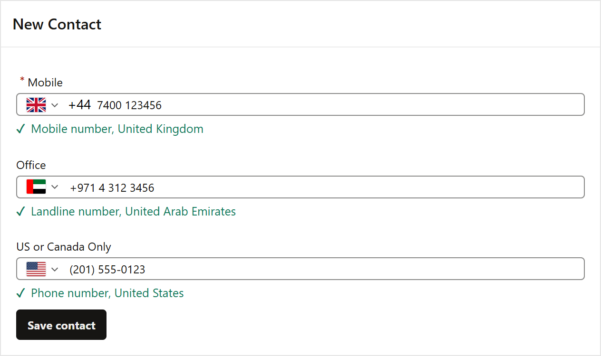

# Phone Number for Oracle APEX

A phone field with a country list and flags that formats and checks numbers for every country.

[](https://oracleapex.com/ords/r/aamirkhanz/plugins/phone-number) &nbsp; Sign in as `demo` with the password `Demo`.



| | |
|---|---|
| **Type** | Item plug-in |
| **Internal name** | `COM.TECHREVX.PHONE_INPUT` |
| **Version** | 1.0 |
| **Requires** | Oracle APEX 26.2 or later |
| **License** | MIT |

## What it does

Phone Number replaces a plain text field for phone numbers with one that knows every country's numbering rules. Users pick their country by flag or name, the number is formatted the way people write it there, and you store it in one clean format.

- **Every country**: flags, a searchable country list, an initial country (or the browser's), only some countries, and your main countries at the top. Typing + and a country code picks the country.
- **Formatted as you type**: 020 7946 0018 in the UK, (201) 555-0123 in the US, 050 123 4567 in the UAE.
- **Checked properly**: Google's libphonenumber rules for each country's lengths and number ranges. Allow mobile numbers only when you send text messages, or landlines only.
- **One format in the database**: E.164 such as +442079460018, or international or national format. Invalid numbers are stored as typed, so validations report them.
- **Clear feedback**: a hint under the field says "Mobile number, United Kingdom", or what is wrong: too short, too long, not a mobile number.
- **Checked twice**: Value Required and invalid numbers are reported in the browser before submit, and the stored format is checked again on the server.

## At a glance

- **Countries**: flags, a searchable list, an initial country (or the browser's), only some countries, and countries listed first. Typing + and a country code picks the country.
- **Numbers**: formatted while typing as each country writes them, checked with Google's libphonenumber rules for length and kind (mobile, landline), and stored in one format: E.164 (+447400123456), international or national.
- **Feedback**: a hint under the field with the kind of number and the country, or what is wrong (too short, too long, not a mobile number). Value Required and invalid numbers are reported before the page is submitted, and checked again on the server.
- **JavaScript**: apex.item( "P1_PHONE" ).getValue(), setValue( "+14155552671" ), techrevx.phoneInput.get( "P1_PHONE" ).isValid() and info(). Events: Change, Phone Number - Country Changed, Phone Number - Number Checked.

## Installation

1. Download `plugin/item_type_plugin_com_techrevx_phone_input.sql` from the [latest release](https://github.com/aamirkhanz/apex-plugin-phone-number/releases/latest) (or from this repository).
2. In App Builder, open your application and go to **Shared Components > Plug-ins**.
3. Choose **Import**, select the file and finish the wizard.
4. Set your phone item's type to **Phone Number [Plug-in]** and keep Value Format E.164 for new columns.

Everything the plug-in needs is inside the SQL file, including intl-tel-input; it loads nothing from other sites.

## Example

```sql
-- E.164 values are easy to use everywhere:
select customer_name,
       '<a href="tel:' || mobile || '">' || mobile || '</a>' as call_link
  from customers
 where mobile like '+44%';           -- all UK numbers
```

Use a page template with the label above the field: floating labels sit where the flag is.

## Attributes

### Countries

| Attribute | Type | Default | Description |
|---|---|---|---|
| **Initial Country** | Text |  | Two-letter country code selected when the field is empty, for example us, gb or ae. Leave empty to use the country of the browser's language, for example de for de-DE. A number that starts with + and a country code selects its country by itself. |
| **Only Countries** | Text |  | Two-letter codes of the only countries users can choose, separated by commas. Leave empty for all countries. |
| **Countries First** | Text |  | Two-letter codes of countries listed at the top of the country list, separated by commas, for example the countries most of your customers are in. |
| **Set Country Item** | Page item |  | Page item set to the selected country's two-letter code (in capitals, for example GB) whenever it changes. |

### Number

| Attribute | Type | Default | Description |
|---|---|---|---|
| **Value Format** (required) | Select list | `e164` | How a valid number is stored in the item. E.164 is the best choice for a database and for sending text messages: one format for every country. A number that is not valid is stored as typed, so validations can report it. Values: `e164` E.164 (+447400123456), `international` International (+44 7400 123456), `national` National (07400 123456). |
| **Valid Numbers** (required) | Select list | `mobileFixed` | Which kinds of numbers count as valid, for example only mobile numbers when you send text messages. Values: `mobileFixed` Mobile and Landline, `mobile` Mobile Only, `fixed` Landline Only, `any` Any Valid Number. |
| **Features** | Checkboxes | `flags:search:format:strict:dialCode:hint` | Flags: country flags in the field and the list. Country Search: a search box in the country list. Format as You Type: spaces and brackets as the country writes them. Digits Only: ignores letters and other characters while typing. Separate Dial Code: shows the country code next to the flag. Hint: a line under the field with the kind of number and the country, or what is wrong with it. Values: `flags` Flags, `search` Country Search, `format` Format as You Type, `strict` Digits Only, `dialCode` Separate Dial Code, `hint` Hint. |

## Events

Available in Dynamic Actions, and as jQuery events on the region or item:

- **Phone Number - Country Changed** (`tx-phone-country`)
- **Phone Number - Number Checked** (`tx-phone-check`)

## Value

```text
Value Format    a valid number is stored as
E.164           +442079460018
International   +44 20 7946 0018
National        020 7946 0018
```

A number that is not valid is stored exactly as typed, so a validation or the server check can report it. When the page shows a stored value, E.164 and international numbers select their own country; national numbers use the Initial Country.

On the server, a value in E.164 has to be a + followed by 7 to 15 digits, and other formats may only contain digits, spaces and + ( ) . / -. The browser does the full check for the country.

## Events and JavaScript

```text
Change                           the number or the country changed
Phone Number - Country Changed   this.data = { iso2, dialCode, name }
Phone Number - Number Checked    when leaving the field; this.data = { valid, value, type, error, country }
```

```javascript
apex.item( "P20_PHONE" ).getValue();                  // "+442079460018"
apex.item( "P20_PHONE" ).setValue( "+14155552671" );  // selects the United States
apex.item( "P20_PHONE" ).getValidity().valid;         // false while the number is not valid
techrevx.phoneInput.get( "P20_PHONE" ).info();        // { valid, value, type } or { invalid, value, error, message }
techrevx.phoneInput.get( "P20_PHONE" ).iti;           // the intl-tel-input object
```

### Number types and errors

```text
type:  MOBILE  FIXED_LINE  FIXED_LINE_OR_MOBILE  TOLL_FREE  PREMIUM_RATE  SHARED_COST  VOIP ...
error: TOO_SHORT  TOO_LONG  INVALID_LENGTH  INVALID_COUNTRY_CODE  INVALID
```

### Initialization JavaScript Function

Receives the options and returns them. `itiOptions` is passed to intl-tel-input, for example to translate the country list.

```javascript
function( options ) {
    options.itiOptions = { countryNameLocale: "de", uiTranslations: { searchPlaceholder: "Suchen" } };
    return options;
}
```

## Included libraries

| Library | Version | License |
|---|---|---|
| [intl-tel-input (includes libphonenumber, Apache-2.0)](https://github.com/jackocnr/intl-tel-input) | 29.5.5 | MIT |

See [THIRD-PARTY-NOTICES.md](THIRD-PARTY-NOTICES.md).

## Repository contents

- `plugin/item_type_plugin_com_techrevx_phone_input.sql`: the plug-in, ready to import
- `src/`: the plug-in's own source (PL/SQL in `plugin.pls`, JavaScript and CSS), for reading and reviewing; the SQL file already contains it
- `apexplugin.json`: the plug-in's details for [apex.world](https://apex.world)

## License

MIT, see [LICENSE](LICENSE). The included libraries keep their own licenses.

## More plug-ins

Documentation, updates and more plug-ins for Oracle APEX by [TechRevX](https://www.techrevx.com).
